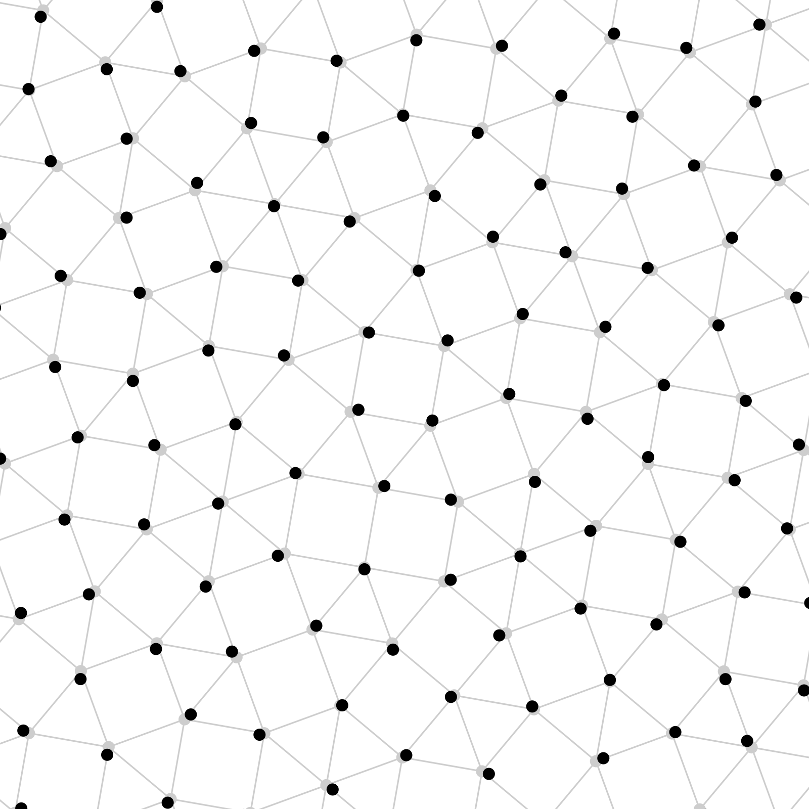
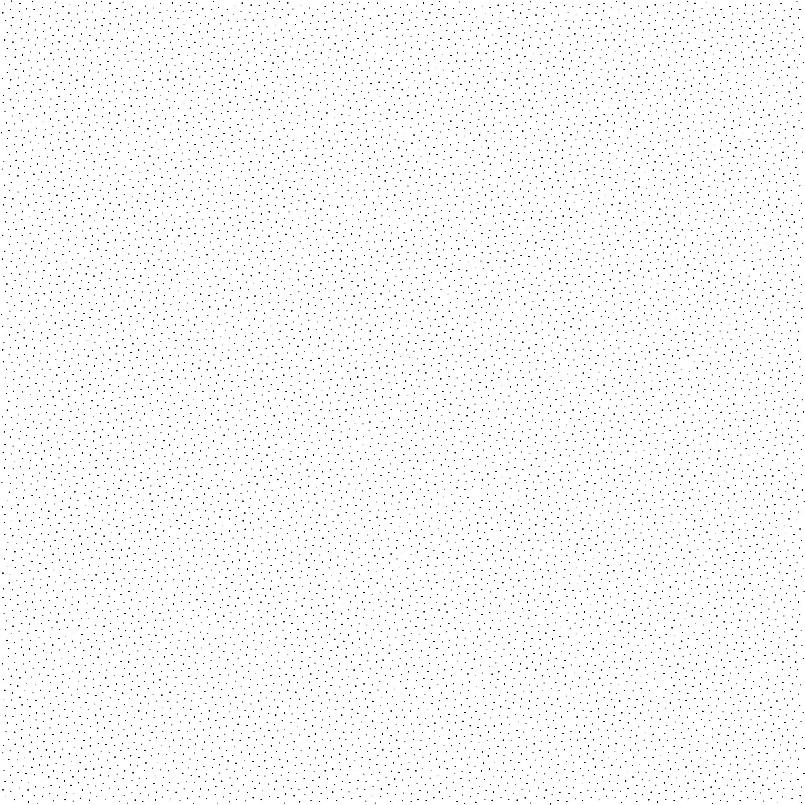
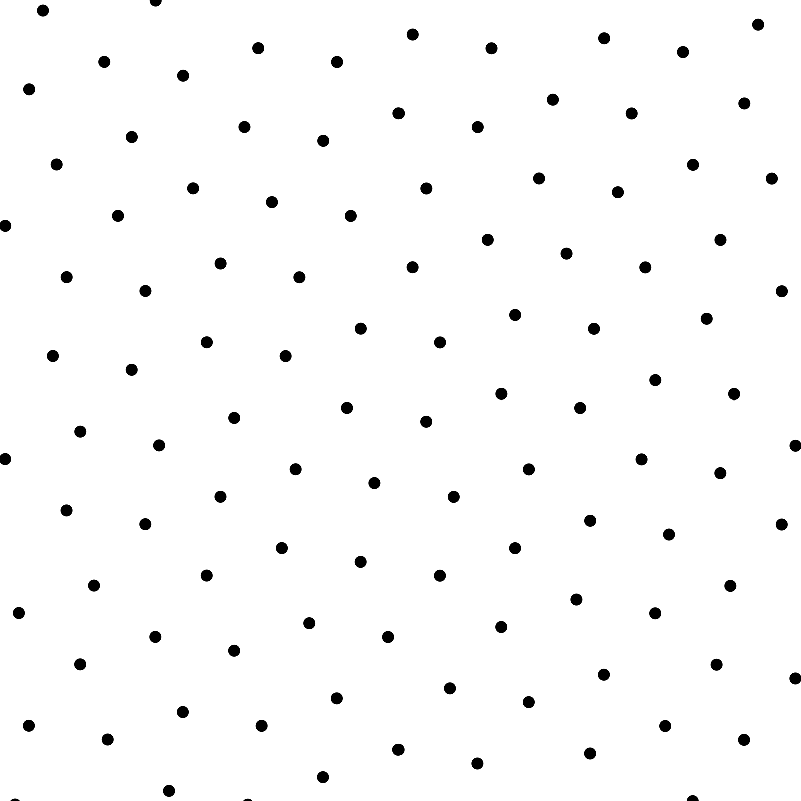
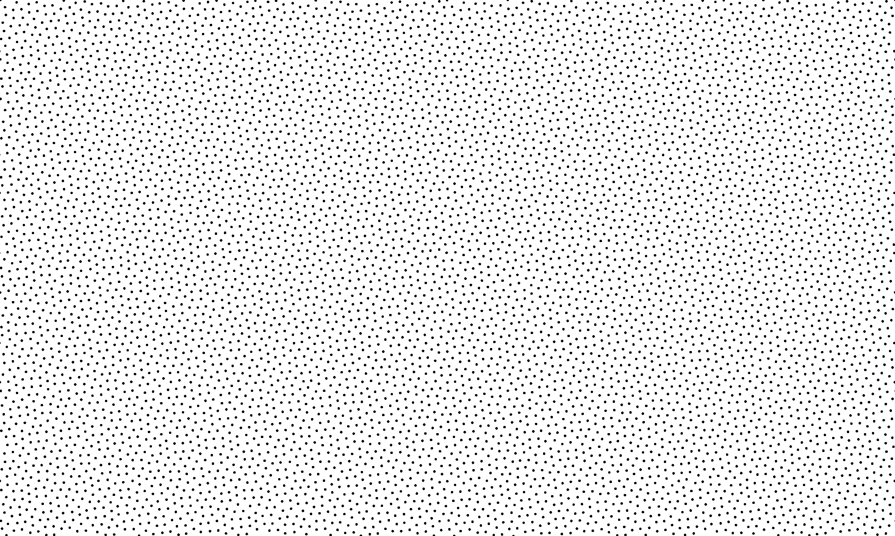

# Point Distribution

Generate square–triangle point patterns, add bounded random displacement, and export the results. Implemented in **Julia**, with reproducible examples and numerical checks.

This project began as a Python experiment and was later implemented in Julia. This repository contains the Julia algorithms and command-line examples. Development was assisted by OpenAI Codex. The square–triangle constructions are based on published tiling methods; the references are credited below.



*Gray edges and dots show the original tiling. Black dots show one independent random displacement per vertex, capped at 10% of the original edge length.*

## Two constructions

| | Planar pattern | Cylinder pattern |
|---|---|---|
| Construction | Five marked Schlottmann square–triangle prototiles | Randomized periodic Stampfli approximant |
| Domain | Finite rectangular crop | Rectangle with its left and right edges joined |
| Main input | Point count, aspect ratio, spacing | Circumference, height, target mean density |
| Noise | One uniform-area disk sample per point | Same displacement distribution; horizontal coordinates wrap |
| Output | PNG, SVG, coordinates and statistics | 1-bit PNG or tiled BigTIFF; example also saves coordinates |

The planar algorithm generates a finite crop of a nonperiodic substitution construction. The cylinder algorithm is **periodic around the circumference**. It is useful when the two horizontal edges need to join, but should not be described as a strictly aperiodic pattern. Neither implementation establishes hyperuniformity or optimizes a blue-noise spectrum.

## Quick start

Use **Julia 1.10 or newer**. The code uses libraries supplied with official Julia distributions; no external Julia packages need to be downloaded. It was checked locally with Julia 1.10.3.

From the repository folder:

```sh
# Planar construction: 10,000 points, maximum displacement 10% of spacing.
julia --project=. run.jl

# Cylinder construction: a small, reproducible PNG example.
julia --project=. cylinder/run.jl

# Run geometry, sampling, spatial-search and export checks.
julia --project=. test/runtests.jl
```

Edit `config.toml` for the planar settings, or the settings at the top of `cylinder/run.jl` for the cylinder example. The default examples write into `generated/`, which is ignored by Git. Existing outputs at those paths are replaced when rerunning.

PNG export needs only Julia. **Cylinder TIFF export additionally requires the `vips` command-line tool** from libvips. To use it, change the cylinder example's output extension to `.tif`. A BigTIFF-capable viewer is needed for large TIFFs.

## How the planar algorithm works

1. **Inflate and substitute.** Start with marked square type 4. Inflate by `2 + sqrt(3)`, then replace each tile using the five published marked rules. The marks distinguish three triangle states and two square states; the visible shapes are equilateral triangles and squares.
2. **Merge shared geometry.** Transform each child by its parent's position, rotation and reflection. Deduplicate overlapping copies and check that their types and replacement orientations agree. Four generations produce 84,198 unique tiles and 55,321 unique vertices.
3. **Crop a rectangle.** Rotate the vertex set and expand a centered rectangle until it contains the requested number of vertices. A tie at the crop boundary is reported rather than resolved by deleting arbitrary points. Verify crop coverage and original nearest-neighbor spacing.
4. **Perturb the vertices.** Draw one independent displacement, uniformly in disk area, for every selected point. A seeded SplitMix64 generator makes the sampling reproducible. There is no rejection, spacing optimization or repeated sampling.
5. **Export and measure.** Write the coordinates, tile edges, rendered images and measured statistics. Spatial buckets restrict nearest-neighbor diagnostics to nearby cells instead of comparing every pair.

The rule coordinates are stored in `data/substitution.toml`; runtime generation does not parse a paper or download data. Their derivation, rounding tolerances and source attribution are recorded in [data/PROVENANCE.md](data/PROVENANCE.md).

### What “10% noise” means

For original spacing `d`, set the displacement cap to `R = 0.10 × d`. For independent uniform draws `u` and `v` in `[0, 1)`:

```text
r = R × sqrt(u)
theta = 2 × pi × v
delta = (r × cos(theta), r × sin(theta))
```

The square root makes samples uniform over the **area** of the disk. The cap limits movement from the original position, not the percentage change in nearest-neighbor spacing. If original nearest-neighbor distances are `d`, the perturbed distances lie between `max(0, d - 2R)` and `d + 2R`, provided the original neighbors are retained in the crop. The implementation checks that condition for the planar example.

At the default spacing of 100 pixels, 10% noise means at most 10 pixels of movement and a conservative nearest-neighbor range of 80–120 pixels. Actual measurements are saved to `statistics.toml`.

### Planar parameters

| Setting | Meaning |
|---|---|
| `points` | Requested number of vertices |
| `spacing_px` | Original unit tile-edge length in pixels |
| `noise_percent`, `seed` | Maximum displacement and reproducible noise seed |
| `aspect_ratio` | Rectangle width divided by height |
| `generations` | Substitution depth; `0` selects a conservative estimate |
| `crop_center`, `crop_rotation_radians` | Crop position and orientation |
| `dot_radius_px` | Rendered dot radius |
| `output_dir` | Output folder, relative to the configuration file |

Point count, spacing and aspect ratio determine the crop size; arbitrary count, dimensions and spacing cannot all be chosen independently. Repeating a rendered crop would create a periodic pattern. The default planar raster is approximately 9,667 × 9,667 pixels; generation can require noticeable time and memory. Tile counts grow quickly with substitution depth.

## How the cylinder algorithm works

The three files in `cylinder/` are the calculation functions used by the later desktop application, preserved without its interface:

- `1_tiling_coordinates.jl` constructs a square–triangle tiling with compatible periodic boundaries. Integer coefficients in the basis `1, sqrt(3)` prevent duplicate shared vertices. Seeded choices select between two compatible local fillings. The automatic mode selects a coarse lattice period and refinement depth to approach the requested mean density, and reports the achieved error.
- `2_add_noise.jl` applies one bounded disk-uniform displacement per point. Horizontal coordinates wrap modulo the circumference. Vertical coordinates can move beyond the top and bottom; rendered circles are clipped there.
- `3_output_dots.jl` renders filled circles as packed 1-bit stripes, without allocating the entire raster. Circles crossing the horizontal join continue on the opposite edge. Optional cutouts use the full image's pixel grid.

Rectangle dimensions are in **meters**, coordinates and spacing in **millimeters**, and density in **points per square inch**. Mean density and density measured in a finite crop can differ at the top and bottom boundaries. Automatic density selection can report an unmet tolerance; it does not silently guarantee the target.

For noise cap `R` and spacing `d`, the cylinder noise function returns the fraction `2R/d` as a conservative noise-induced distance-change bound. This is a bound relative to `d`, not a measurement of a particular sample or a bound on 3D chord distance. The exporter uses it to reject dot radii for which geometric nonoverlap cannot be guaranteed.

## Sample outcomes

The checked-in examples are generated by this Julia implementation:

| Planar overview: 10,000 noisy points | Detail: original positions |
|---|---|
|  |  |



*Cylinder output is shown unrolled. Its left and right edges join; the top and bottom do not.*

Regenerate these samples and their parameter/measurement files:

```sh
julia --project=. examples/generate_samples.jl
```

The planar geometry is also checked against the original Python-produced positions in `examples/approved-coordinates.csv`. Julia's fresh random displacements use a different generator, so a matching seed does not reproduce NumPy's individual draws. To render the saved Python coordinates without resampling:

```sh
julia --project=. render_saved.jl
```

## Code map and checks

| Path | Purpose |
|---|---|
| `src/geometry.jl` | Substitution, deduplication, rectangular cropping and spatial queries |
| `src/noise.jl` | Seeded disk-uniform displacement |
| `src/render.jl` | PNG and SVG rendering |
| `src/pipeline.jl` | Configuration, validation and exports |
| `data/` | Geometric substitution rules and provenance |
| `cylinder/` | Periodic geometry, bounded noise and packed-bit export |
| `examples/` | Reproducible examples, reference coordinates and selected outcomes |
| `test/` | Geometry/reference agreement, noise bounds, nearest-neighbor checks and export validation |

The tests compare 10,000 planar positions with the original reference, check crop coverage and tile counts, compare the spatial search with exhaustive distances on a small fixture, and verify image encoding. Cylinder checks exercise periodic distances across the join, noise limits, reproducibility and PNG output. These are numerical implementation checks, not a proof of aperiodicity or a performance benchmark for every parameter choice.

## References

- [Tilings Encyclopedia: square–triangle substitution](https://tilings.math.uni-bielefeld.de/substitution/square-triangle/) — marked tile types and construction attribution.
- [D. Frettlöh, *A fractal fundamental domain with 12-fold symmetry*, Figure 1](https://www.math.uni-bielefeld.de/~frettloe/papers/12fdwin-arx.pdf) — geometric rule source for the planar implementation.
- [Substitution data provenance](data/PROVENANCE.md) — recovery method and numerical tolerances.
